> 本文由软件作者提供的图文介绍整理而来，界面截图均为设备功能演示截图。

# AI+网络运维平台

> **把设备接入、日常巡检和配置变更，放在一个本地运维工作台中完成。**

AI+网络运维平台面向网络工程师与网络运维团队，提供统一的设备连接、实时 CLI、配置备份、巡检、拓扑发现、抓包分析、配置漂移、审计和 AI+ 辅助能力。既可连接真实设备，也可使用内置模拟设备体验主要功能；涉及配置写入时，须经人工确认后执行。

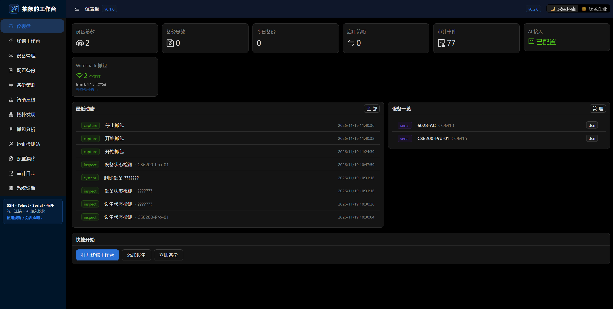

## 多种连接方式，一个工作台操作

支持 SSH、Telnet、Serial 串口和模拟设备；添加设备时可先测试连接，再通过设备列表进入 CLI 会话。当前带外接入通过管理口 IP 和 SSH 实现。

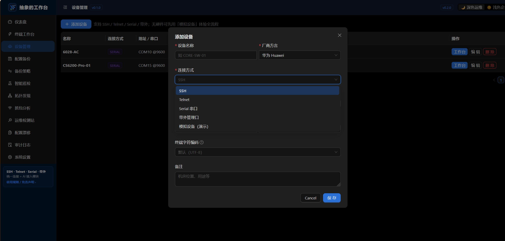


## AI+ 辅助分析与变更

接入 OpenAI Chat Completions 兼容 API 后，可进行运维问答、配置分析和变更命令生成。支持导入 PDF、Word（DOCX）和 TXT 操作手册作为参考资料；变更命令须经人工确认后才会执行。

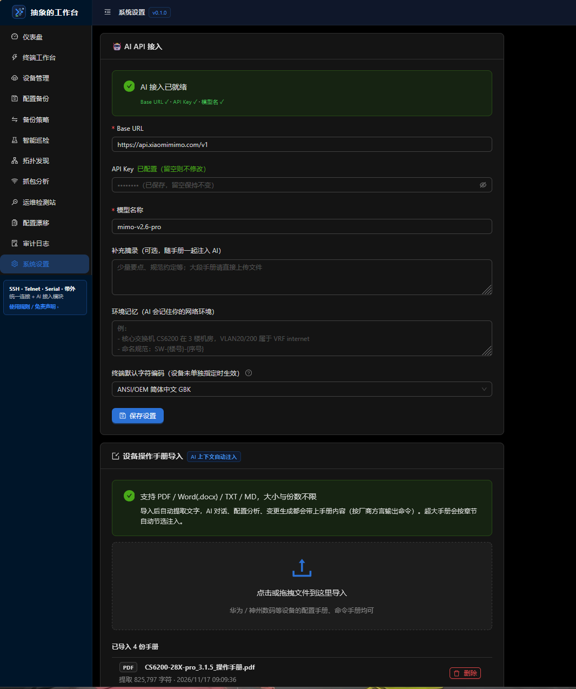

## 配置备份与审计留痕

支持手动和定时备份配置、查看并下载备份；备份、AI 调用和变更执行等操作均可在审计记录中查看。

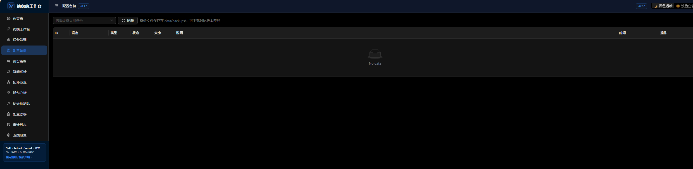

## 连接与兼容

- **设备连接：** SSH、Telnet、Serial 串口、模拟设备；带外管理当前使用管理口 IP + SSH。
- **设备命令方言：** 内置华为、H3C、神州数码 DCN、Cisco 相关适配。
- **AI API：** OpenAI Chat Completions 兼容接口，可配置 Base URL、API Key 和模型名；具体服务商需提供兼容端点。
无真实设备时，可用内置模拟设备体验 CLI、备份、AI+ 分析和变更确认流程。

## 本地运行与安全提示

软件默认仅监听本机地址，设备密码加密保存在本地。若要开放给局域网使用，请先配置适当的身份认证和网络访问控制；Telnet 为明文协议，仅建议用于受控环境。


## 软件模块说明

以下按软件左侧导航逐一介绍各模块。AI+ 与变更闸门集成在终端工作台中，深浅主题切换和使用规则则属于全局功能。

### 1. 仪表盘

汇总设备数量、备份情况、启用中的备份策略、审计事件及 AI 和抓包组件状态，并展示最近动态、设备一览和常用快捷入口，便于快速了解当前运维概况。

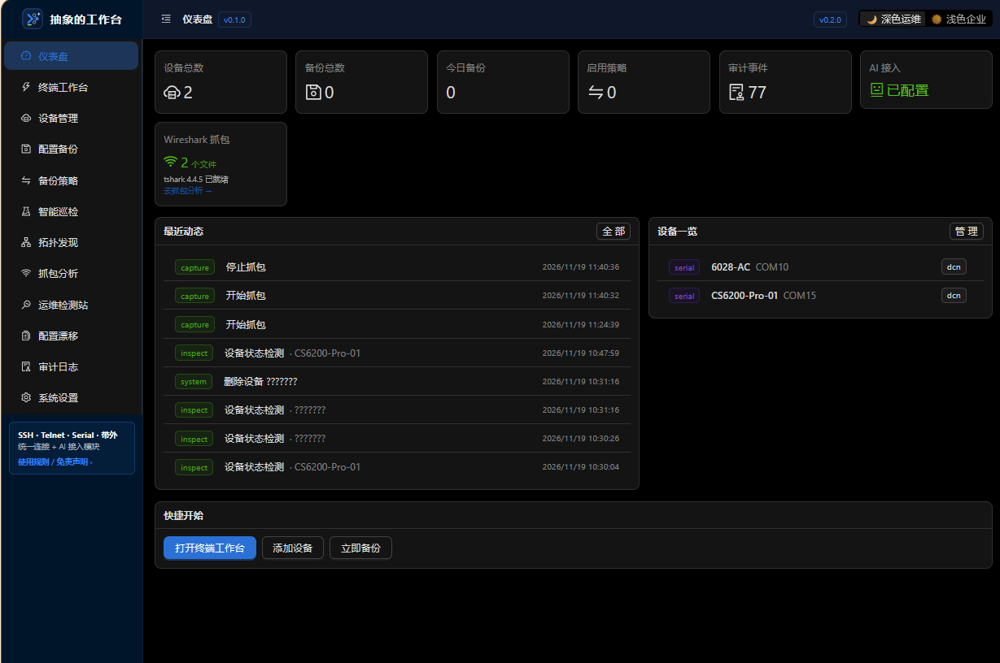


### 2. 终端工作台

通过连接树选择设备并开启实时 CLI 会话，可查看连接与会话日志。工作台内置 AI+ 模块，可进行运维问答、配置分析和命令生成；涉及设备变更时，通过配置写入预览命令并由人工确认后执行。

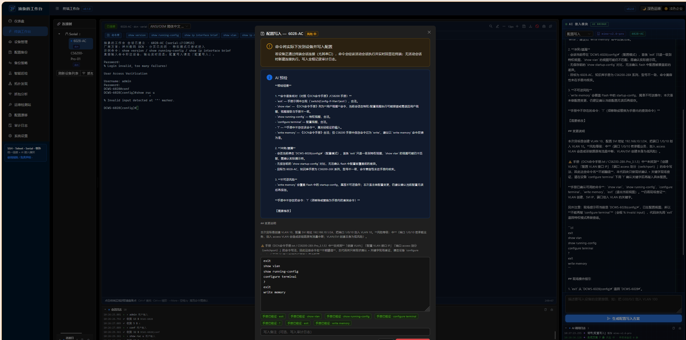

AI接入模块可选型号为四种，每种对接的形式又略有不同但是唯一可写入的模式为配置写入。

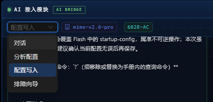

连接树是在设备管理中已经接入的设备或者是已经写入的设备的调用模块，可区分连接线或者是分组管理如设备厂商不同可分为不同厂商的组或是不同楼栋之间的设备管理可分楼栋组。

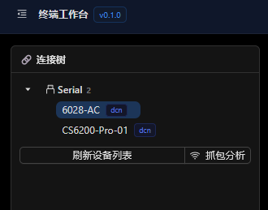

终端模块中还有一个会话日志，内容为你在设备终端中做的任何一条输入的日志记录。

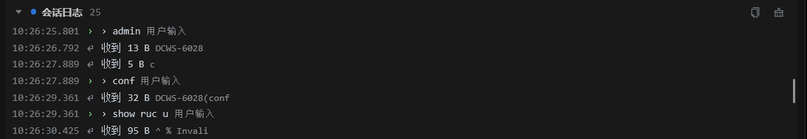

### 3. 设备管理

集中新增、编辑和管理设备资料，设置设备厂商方言、连接方式及地址或串口参数，并保存用户名、密码、字符编码和备注等信息；支持 SSH、Telnet、Serial、模拟设备，添加前可测试连接。

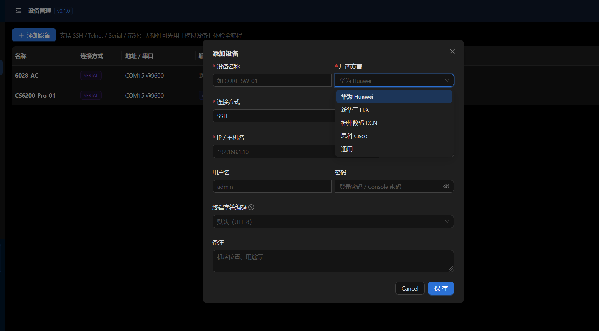

可区分的不只是厂商标注，也可以区分连接方式。

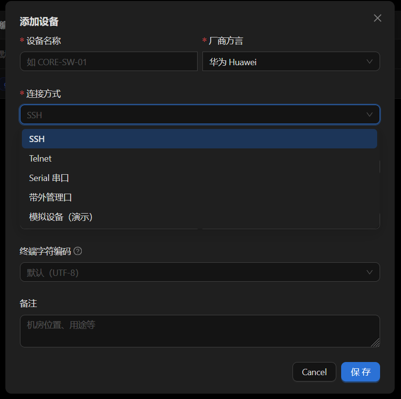

### 4. 配置备份

可对指定设备立即备份运行配置，并查看备份设备、类型、状态、文件大小和时间；成功的备份可以下载，也可清理不需要的记录。

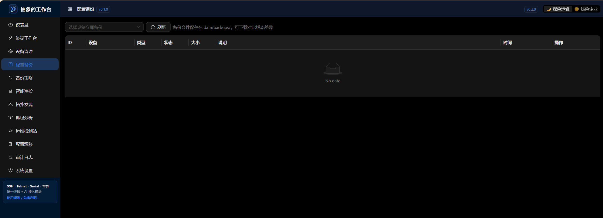

### 5. 备份策略

为一台或多台设备创建定时备份计划，选择备份类型、执行间隔并启用或停用策略；列表会显示策略状态和下次执行时间。

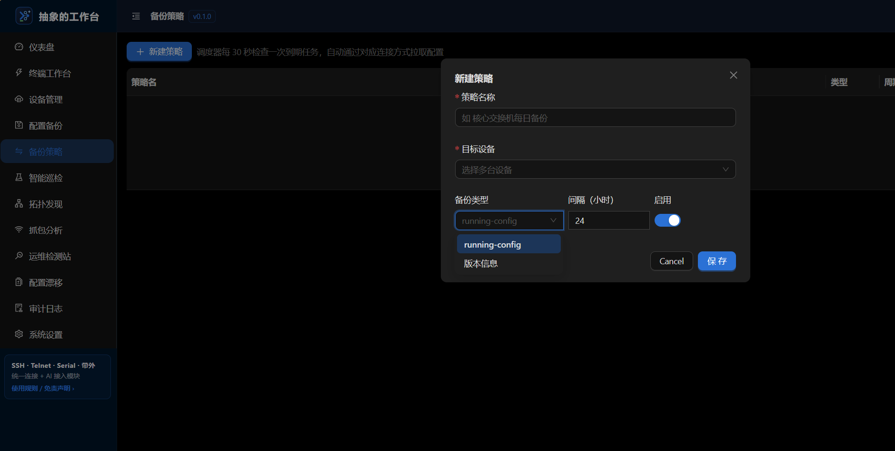


### 6. 智能巡检

自动采集设备版本、接口和运行配置等信息，从安全、规范、容量、稳定性等维度进行规则检查，生成综合评分、分级问题和整改命令；还可查看 AI+ 分析建议及抓包审查结果。

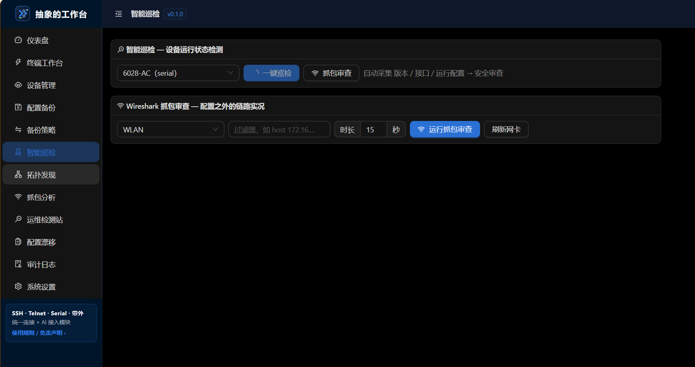

可对当前设备安全运维以及端口管理给出一个更加安全以及网络更加稳定的整改建议。

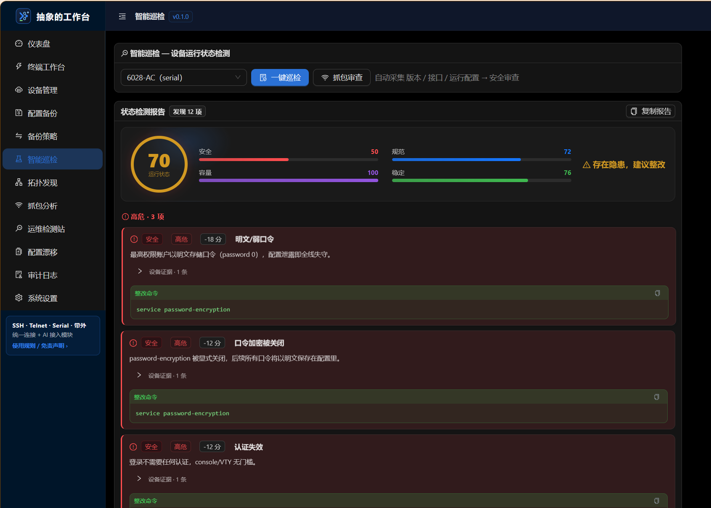

### 7. 拓扑发现

读取设备的邻居发现、ARP 和接口地址等信息，推断一跳邻居并绘制网络拓扑图；也可通过抓包被动识别链路上的 LLDP、CDP、STP 等通告，不必登录被动发现的邻居设备。

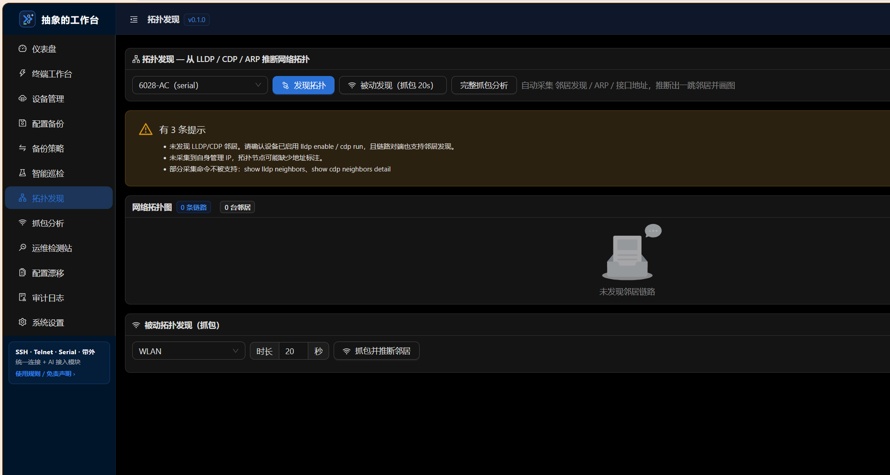

### 8. 抓包分析

选择本机网卡、设置过滤条件和抓包时长或包数上限，采集并分析网络流量，查看协议分布、IP 会话、IP 端点和专家信息。此功能依赖 Wireshark/Npcap，抓包通常需要相应的系统权限。可将电脑或者服务器端口连接到我们需要运维或是安全检查的设备上，然后讲设备上的所有出口以及入口流量都镜像到连接到我们电脑的端口来进行网络抓包，查看是否又非法或者是错误的数据报文。

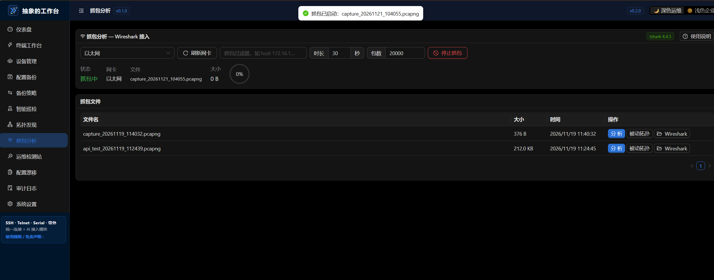

### 9. 运维检测站

按选择的检测项采集设备配置、协议、状态或数据，并以正常、关注、异常或不支持等状态展示结果；检测项可管理和自定义，还能请求 AI+ 解读结果或进行抓包级检测。

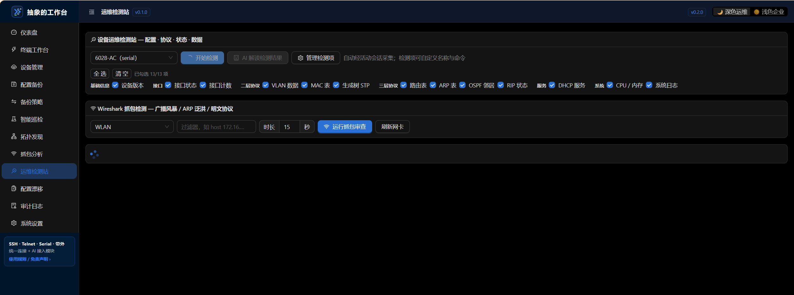

在运维检查站点当中可以检查到你想对该设备检查到的该协议状态等。

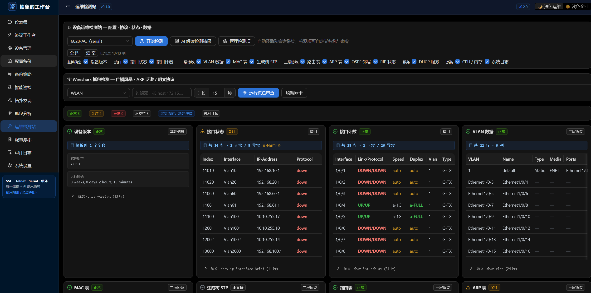

运维检查站点可自定义来管理需要检查到的点。

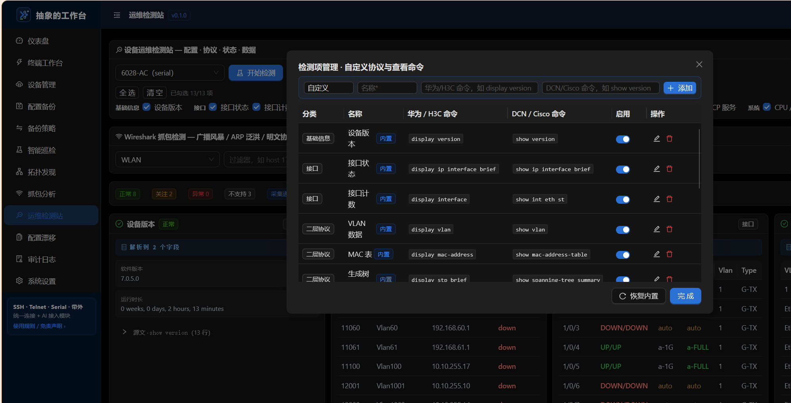

### 10. 配置漂移

对比同一设备最近两份成功备份，标记配置一致、已变化或备份不足，并查看逐行差异；可进一步请求 AI+ 总结变更内容并分析潜在风险。

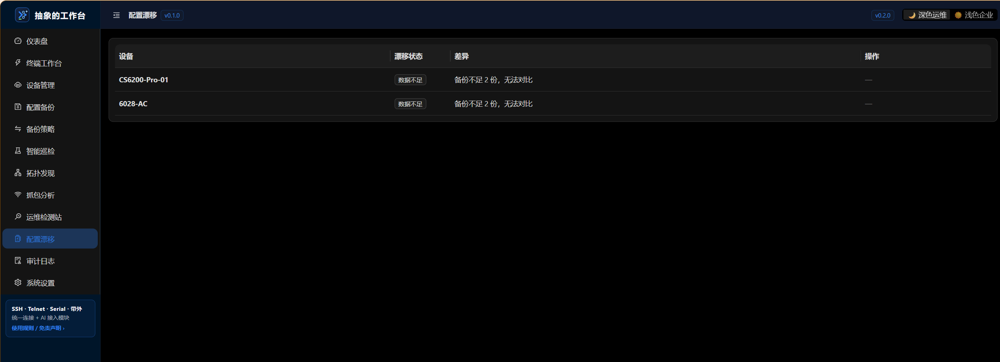

### 11. 审计日志

按备份、变更、AI、连接和系统等类型筛选操作记录，查看设备、操作内容、执行状态、详情和时间，便于追踪运维活动。

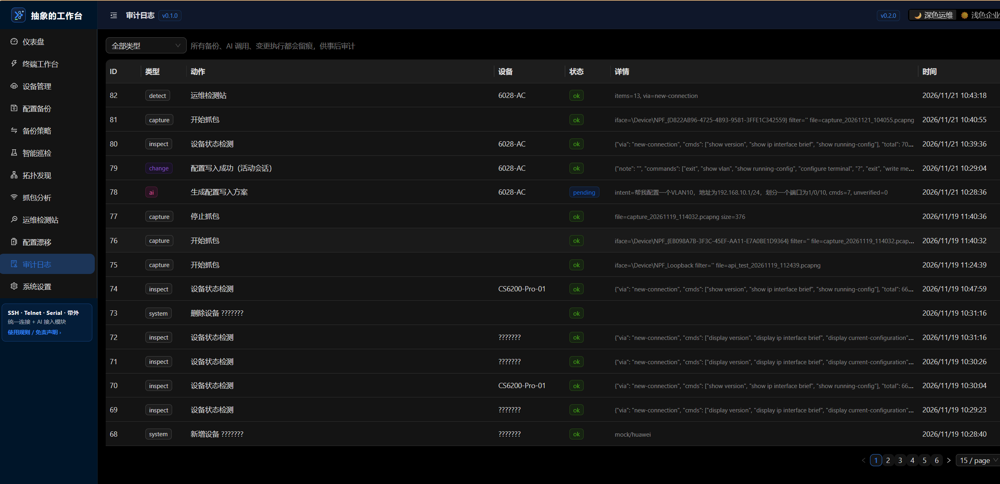


### 12. 系统设置

配置 OpenAI Chat Completions 兼容 API 的地址、密钥和模型，导入设备操作手册，补充网络环境记忆，并设置终端默认字符编码；同时可管理已导入的手册和查看连接方式说明。

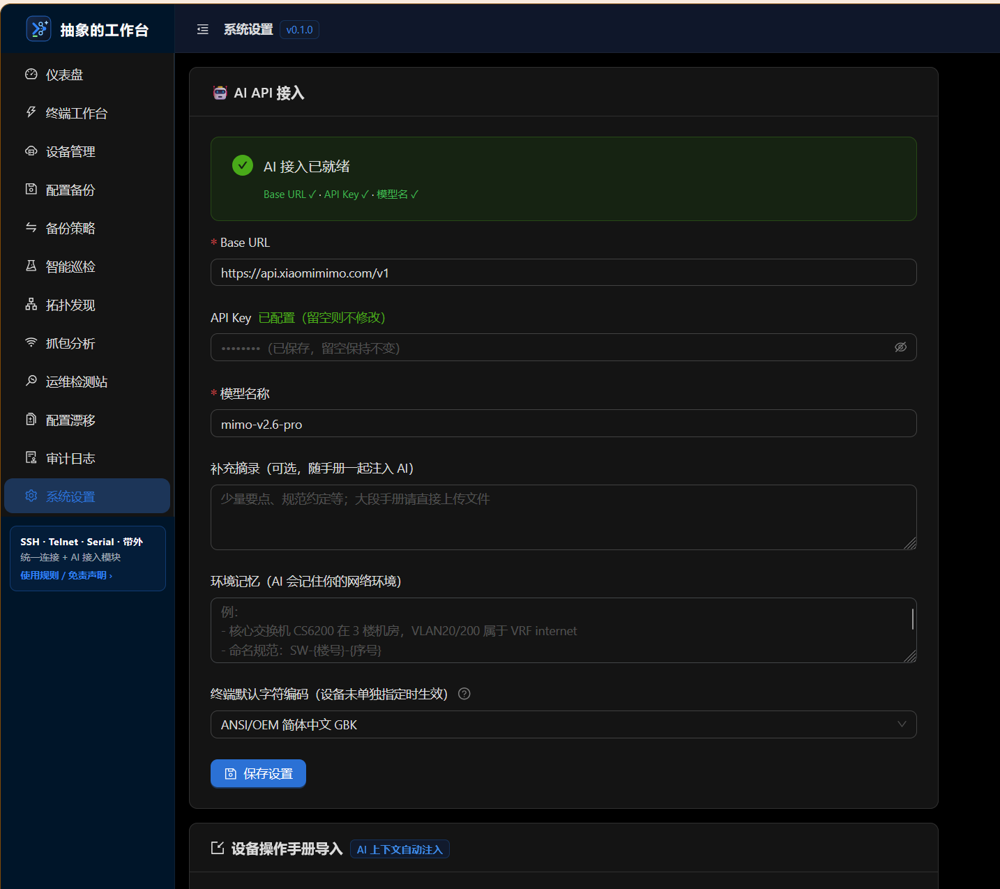

全局外观：顶部可在深色运维主题与浅色企业主题之间切换；侧栏提供连接规则与免责声明。


## 免责声明如下

### 软件性质（现状提供）

本软件按"现状"（AS IS）提供，属于网络运维辅助工具，仍可能存在缺陷或不完整之处。使用前请在测试环境充分验证。

### 不提供任何保证

不保证软件的安全性、可靠性、适用性；不保证与所有网络设备（含各厂商、各版本）的兼容性；不保证运行稳定、无错误或不间断。

### 责任免除

在法律允许的最大范围内，作者与贡献者对因使用或无法使用本软件导致的任何直接、间接、附带、特殊或后果性损害不承担责任，包括但不限于：设备故障、配置丢失、网络中断、业务损失、数据泄露、利润损失。

### AI 内容免责

AI 接入模块生成的命令、分析、建议由第三方大模型服务产生，不构成专业网络工程意见，可能包含错误。执行风险与后果由使用者自行承担。

### 第三方服务

本软件的 AI 能力依赖第三方 OpenAI 兼容 API 服务，其可用性、数据处理规则与合规责任由相应服务商承担；向 AI 服务发送配置内容前，请评估敏感信息泄露风险。

### 用户责任

使用者自行承担使用本软件的全部风险，并对设备操作的合法性、合规性、安全性负责；因违规使用产生的一切后果与法律责任由使用者及所在单位承担。

### 安全建议

仅在隔离/受控环境使用；生产环境操作前备份配置；启用审计日志；限制软件运行主机的访问权限；定期更新至最新版本。

### 法律适用

本声明受中华人民共和国法律管辖。软件所含开源组件遵循其各自的许可协议。本声明可能不定期更新，继续使用软件视为接受更新后的条款。

版本 v0.2 · 本模块内容参考网络安全工具行业通行条款与开源项目免责声明框架撰写，供内部治理使用；如用于正式商用发行，请由法务复核。

---

## 使用教程（0.2.0）

### 1. 运行环境

- Windows 10/11
- Python 3.10 或更新版本
- Node.js 18 或更新版本（用于安装和构建前端）
- Git
- 抓包功能需要另外安装 Wireshark 和 Npcap；真实设备连接需要本机能够访问设备

GitHub 仓库提供源码，不包含 `dist_app` 下的打包可执行文件。按以下步骤安装依赖并从源码运行。

### 2. 安装并启动

在 PowerShell 中执行：

```powershell
git clone https://github.com/AbstractNetworkEngineer/ai-plus-network-ops.git
cd ai-plus-network-ops

py -3 -m venv .venv
.\.venv\Scripts\python.exe -m pip install --upgrade pip
.\.venv\Scripts\python.exe -m pip install -r backend\requirements.txt

Push-Location frontend
npm ci
npm run build
Pop-Location

.\.venv\Scripts\python.exe backend\run_app.py
```

启动脚本会打开浏览器，默认地址为 `http://127.0.0.1:18765`。前端构建完成后，也可以双击仓库根目录的 `启动抽象的工作台.bat` 启动。停止服务时关闭启动窗口即可。

后端 API 文档可在服务启动后访问 `http://127.0.0.1:18765/docs`。

#### 前端开发模式

需要热更新时，先在一个 PowerShell 窗口启动后端：

```powershell
Push-Location backend
..\.venv\Scripts\python.exe -m uvicorn main:app --reload --host 127.0.0.1 --port 18765
Pop-Location
```

另开一个窗口启动 Vite：

```powershell
Push-Location frontend
npm run dev
Pop-Location
```

开发页面地址为 `http://127.0.0.1:5173`，API 和 WebSocket 请求会代理到 `127.0.0.1:18765`。

### 3. 首次启动与数据位置

首次启动会初始化本地 SQLite 数据库、访问令牌和设备密码加密密钥。源码运行时，数据库及备份等数据保存在仓库根目录的 `data/` 下，包括：

- `data/netdeck.db`：设备、设置、策略和审计记录
- `data/backups/`：设备配置备份
- `data/manuals/`：导入的操作手册
- `data/.secret_token`、`data/.secret_key`：本机访问令牌和加密密钥

`data/` 已加入 Git 忽略规则。不要把它、API Key、设备配置或真实网络信息提交到公开仓库。

### 4. 添加设备并打开终端

1. 进入 **设备管理**，选择 **添加设备**，填写名称、厂商方言和连接方式。
2. 真实设备按所选方式填写连接参数：SSH/Telnet 填主机地址和账号；Serial 填本机 COM 口及波特率；带外管理当前通过管理口 IP + SSH 接入。
3. 先测试连接，再保存设备。可用的厂商方言包括华为、H3C、神州数码 DCN、Cisco 和通用 show 风格；实际命令兼容性仍取决于设备型号、系统版本和权限。
4. 没有设备时可选择 **模拟设备（演示）**，体验终端及相关流程。
5. 进入 **终端工作台**，在连接树中选择设备并打开会话；会话日志用于回看终端交互。

### 5. 配置 AI+

进入 **系统设置 → AI API 接入**，填写服务商提供的 OpenAI Chat Completions 兼容 **Base URL**、**API Key** 和**模型名称**，保存后查看接入状态。接口需兼容 `/chat/completions` 请求格式；API Key 请只在本机设置中填写，不要放进文档、截图或 Git 提交。

终端工作台中的 AI+ 有四种模式：

- **对话**：运维相关问答
- **分析配置**：分析设备配置中的安全、规范和优化问题
- **配置写入**：根据意图生成配置命令；提交前检查风险和目标设备，并在变更闸门中确认后才执行
- **排障向导**：根据故障现象逐步给出诊断建议和命令

AI 的输出可能有误；生产环境操作前应先备份，并人工核对命令、设备和变更影响。发送配置给第三方 AI 服务前，请先确认其中不含不应外传的信息。

#### 导入设备操作手册

在 **系统设置 → 设备操作手册导入** 中拖入或选择 PDF、DOCX、TXT、MD、LOG、CFG 或 CONF 文件。可补充网络环境记忆和摘录；导入内容会作为 AI+ 的参考上下文。不要导入包含密码、密钥或不宜发送到第三方 AI 服务的敏感资料。

### 6. 备份与策略

- **配置备份**：选择设备立即备份运行配置；列表显示结果、大小和时间，成功记录可下载。
- **备份策略**：新建策略，选择一个或多个设备、备份类型（running-config 或版本信息）、间隔小时数并启用。间隔可设为 1–720 小时，列表会显示下次执行时间。
- **配置漂移**：每台设备至少需要两份成功备份。模块会对比最近两份备份，显示是否变化和逐行差异；可请求 AI+ 解读风险。

### 7. 巡检、检测和拓扑

- **智能巡检**：选择设备后运行一键巡检；报告从安全、规范、容量、稳定性等维度汇总结果、问题级别和整改命令，也可查看 AI+ 建议。
- **运维检测站**：选择并运行检测项，查看正常、关注、异常或不支持结果；可管理自定义检测项，并请求 AI+ 解读。
- **拓扑发现**：选择设备执行主动发现，根据邻居协议、ARP 和接口信息推断直连邻居。设备需启用相应邻居发现协议；也可使用被动抓包识别链路中的 LLDP/CDP/STP 通告。

### 8. 抓包分析

安装 Wireshark（需包含 `tshark`/`dumpcap`）和 Npcap 后，进入 **抓包分析**，选择网卡、设置可选的 BPF 过滤条件及时长/包数上限，再开始抓包和分析。结果包含协议分布、IP 会话、IP 端点和专家信息；抓包驱动通常需要管理员权限。

智能巡检、运维检测站和拓扑发现也提供抓包审查或被动发现入口。没有抓到包时，检查网卡选择、Npcap 安装、权限和过滤条件；被动拓扑没有邻居时，确认链路上确实有 LLDP/CDP/STP 通告。

### 9. 审计、外观和终端编码

- **审计日志**：按备份、变更、AI、连接、系统等类型筛选记录，查看设备、操作、状态、详情和时间。
- **深浅主题**：在顶部切换深色运维主题或浅色企业主题。
- **终端编码**：在系统设置设置默认字符编码，也可在设备设置中单独指定；中文显示异常时按设备实际编码调整。

### 10. 真实设备与安全注意事项

| 连接方式 | 使用说明 |
|---|---|
| SSH | 确认设备已启用 SSH、网络可达且账号有相应权限 |
| Telnet | 明文传输，仅在隔离或受控实验网络使用 |
| Serial | 需要本机 USB-Console 线、正确的 COM 口和波特率 |
| 带外 | 当前版本通过管理口 IP + SSH 接入；Redfish/IPMI 尚未实现 |
| 模拟设备 | 无需真实硬件，可体验基础终端和运维流程 |

软件默认只监听本机 `127.0.0.1`。不要在不可信网络中改为 `0.0.0.0`：当前版本没有登录认证，访问令牌会随页面提供给本机浏览器。设备密码以加密形式保存，但这不代表可以公开数据库或密钥文件。重要操作前备份配置，并遵守设备所有者的授权和变更流程。

默认端口为 `18765`。如需更改，在同一个 PowerShell 窗口中先设置环境变量再启动：

```powershell
$env:ABSTRACT_WORKBENCH_PORT = "18766"
.\.venv\Scripts\python.exe backend\run_app.py
```

## 许可证

本项目采用 [MIT License](LICENSE)。文档中的界面截图来自设备功能演示环境。
